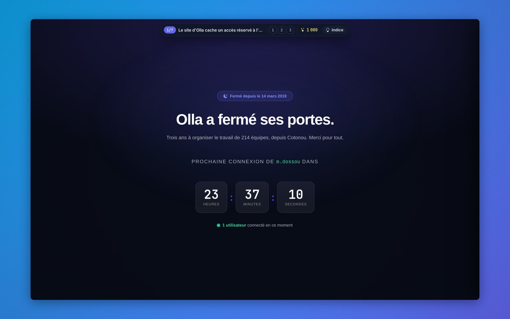
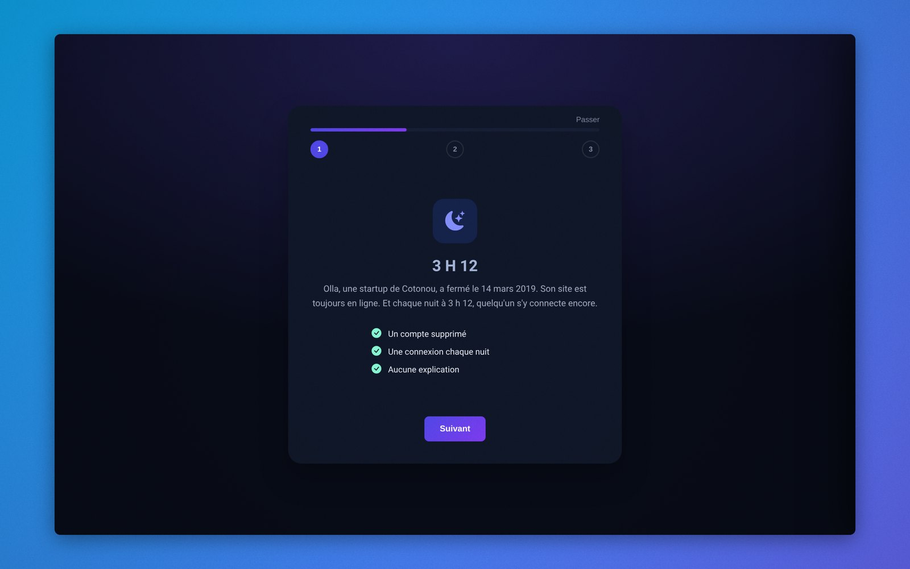
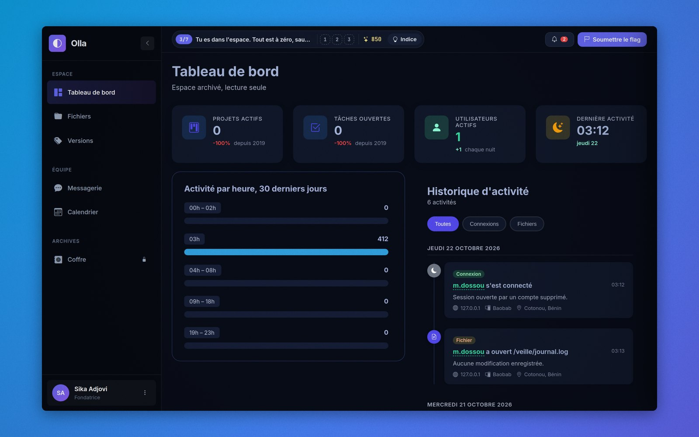
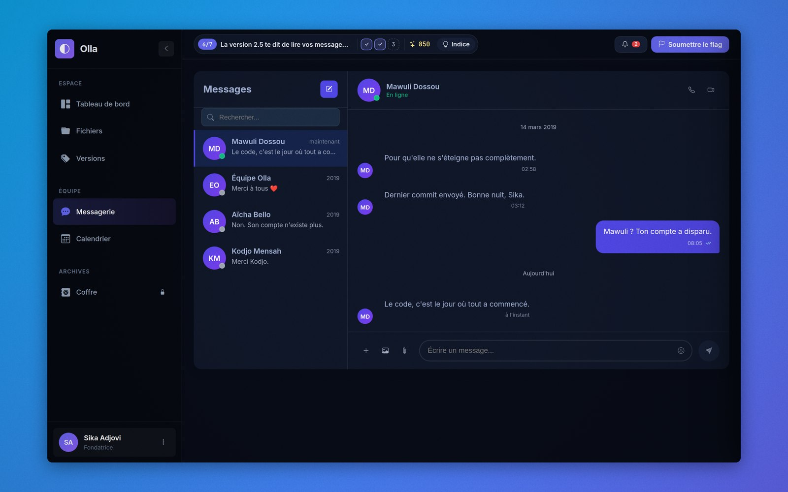
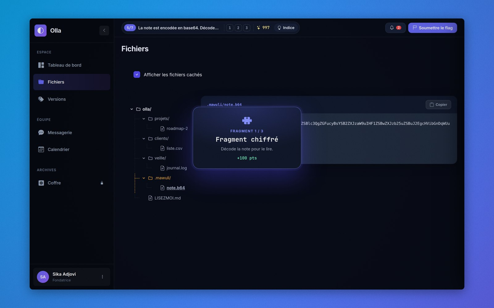
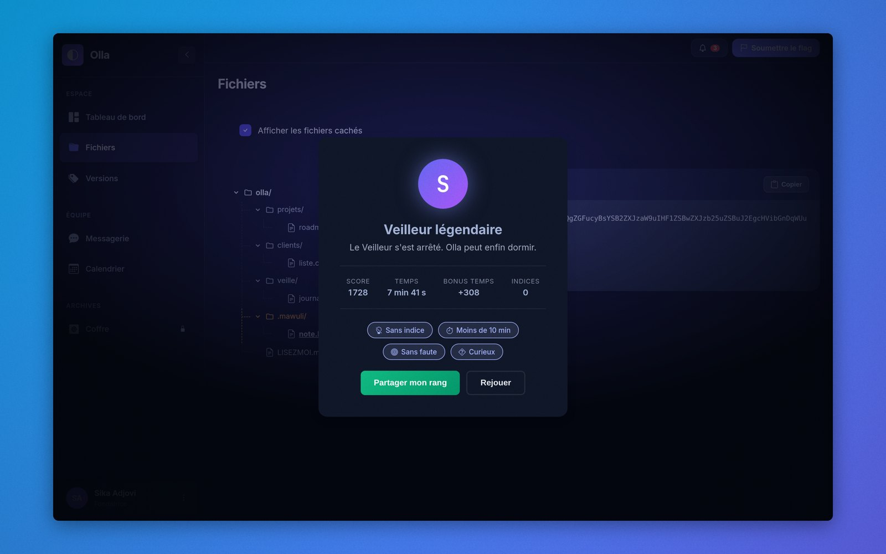

# 3 H 12

> Olla a fermé ses portes le 14 mars 2019. Son site est toujours en ligne.
> Et chaque nuit à 3 h 12, quelqu'un s'y connecte encore.

Un jeu d'enquête de 15 minutes, dans le navigateur, construit avec les composants [LibraryUI](https://libraryui.com).
Projet réalisé pour le **Challenge #01 LibraryUI : « Crée une interface avec des composants de LibraryUI »**.

**Jouer : [libraryui-3h12.vercel.app](https://libraryui-3h12.vercel.app)**



## Le principe

Tu entres dans le back-office d'une startup fermée depuis 2019. Tout est à l'arrêt, sauf un compte supprimé qui continue
de se connecter chaque nuit. Fouille l'espace, remonte sa trace et reconstitue le flag `LUI{...}`, caché en trois fragments.

- Aucune compétence technique requise, aucun compte à créer
- Un objectif toujours affiché, des indices quand on bloque
- Un score : chaque indice coûte des points, chaque fragment en rapporte
- Un rang à la fin, de C à S, et quatre badges à débloquer

| | |
|---|---|
|  |  |
|  |  |



## Les composants LibraryUI utilisés

Chaque composant garde son markup d'origine. Il a un rôle dans l'histoire plutôt qu'en vitrine.

| Partie | Composants |
|---|---|
| Accueil | Coming soon, Stats section, Our Team, About us, Simple footer |
| Brief | Onboarding |
| Accès | Formulaire de connexion, Mot de passe oublié, Réinitialiser le mot de passe |
| Espace de travail | Sidebar, KPI Cards, Graphe de répartition, Historique des activités, Notifications |
| Enquête | Profil, Skeleton, Message d'erreur, Arborescence de fichiers, Checkbox, Code block, Versioning, Messagerie, Calendrier |
| Coffre | Formulaire OTP, Modal, PDF preview |
| Jeu | Accordion (indices), Confirmation (flag), Message de succès (toasts et rang final), Tag (badges), Page 404 |

Au total, 32 composants.

## Comment c'est construit

- **HTML, CSS et JavaScript sans framework.** Le jeu tient dans un seul fichier, `index.html`, sans étape de build côté navigateur.
- **CSS isolé par composant.** `src/build-maquette.py` lit le CSS d'origine de chaque composant (`src/composants/`) et le
  confine sous une classe `.lui-<composant>`. C'est le même principe que l'encapsulation d'Angular. Plusieurs composants
  partagent des classes génériques (`btn`, `alert`, `auth`) qui, sans ça, se marcheraient dessus.
- **Thème nuit automatique.** Le même script convertit les couleurs claires de chaque composant vers une palette sombre,
  y compris dans leurs variables CSS, sans toucher au markup.
- **Flag protégé.** Seule son empreinte SHA-256 est présente dans le code.
- **Animations** respectueuses de `prefers-reduced-motion`.

## Lancer en local

```bash
python3 -m http.server 8000
# puis ouvrir http://localhost:8000
```

Pour reconstruire `index.html` après une modification de `src/maquette.src.html` :

```bash
python3 src/build-maquette.py   # écrit src/_sorties/index.html
```

## Crédits

- Composants © [LibraryUI](https://libraryui.com), utilisés dans le cadre du Challenge #01.
- Olla, ses personnages et son histoire sont fictifs.
- Icônes : [Bootstrap Icons](https://icons.getbootstrap.com). Polices : Inter et JetBrains Mono.
